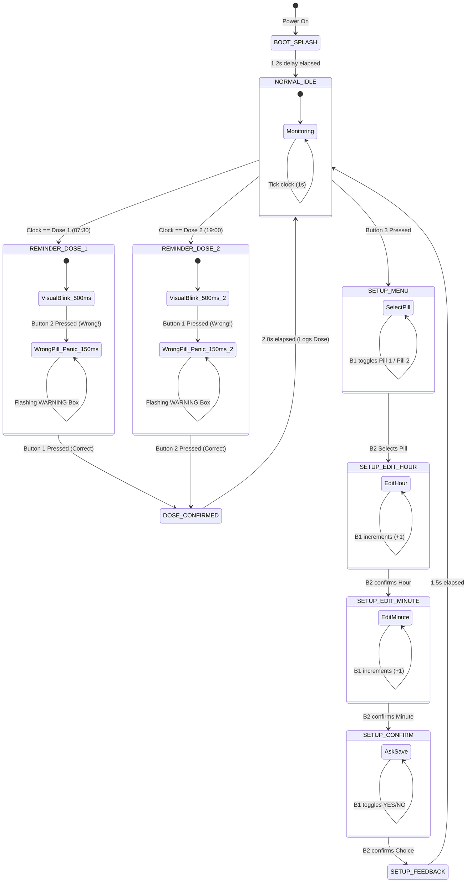

# Smart Pill Box Embedded C Firmware
## Comprehensive Technical Guide & Code Walkthrough

This document provides a complete, pedagogical breakdown of the firmware in [`main.c`](file:///Users/harinarayanans/MC/smart_pillbox/src/main.c). It is designed to help you **understand every line of code**, master embedded concepts, and **confidently teach or present it** to professors, peers, and examiners.

---

## 1. System Overview & Architecture

### Hardware Components
| Component | Part / Model | STM32 Pin | Interface / Protocol |
| :--- | :--- | :--- | :--- |
| **Microcontroller** | STM32F103C8T6 (Blue Pill) | — | ARM Cortex-M3 (72 MHz) |
| **Display** | 0.96" OLED (128×64) | **PB6** (SCL), **PB7** (SDA) | Hardware I2C1 (Standard 100 kHz) |
| **Button 1** (Dose 1 / +) | Tactile Pushbutton | **PB12** | GPIO Input (`GPIO_PULLUP`, Active LOW) |
| **Button 2** (Dose 2 / Sel) | Tactile Pushbutton | **PB14** | GPIO Input (`GPIO_PULLUP`, Active LOW) |
| **Button 3** (Setup) | Tactile Pushbutton | **PB15** | GPIO Input (`GPIO_PULLUP`, Active LOW) |
| *LED 1 (Optional)* | Red 5mm LED | **PB1** | Push-Pull Output (`ENABLE_LEDS`) |
| *LED 2 (Optional)* | Green 5mm LED | **PB10** | Push-Pull Output (`ENABLE_LEDS`) |
| *Buzzer (Optional)* | Piezo Buzzer | **PB0** | Push-Pull Output (`ENABLE_BUZZER`) |

---

### Finite State Machine (FSM) Diagram



---

## 2. STM32 Hardware & Peripheral Initialization

### System Clock Configuration (`SystemClock_Config`)
The STM32F103 operates at up to **72 MHz**.
- **Source**: 8 MHz external crystal (HSE - High Speed External).
- **PLL Multiplier**: 8 MHz $\times$ 9 = **72 MHz** SYSCLK.
- **APB1 Bus**: Divided by 2 (36 MHz max for peripheral bus 1, which drives I2C1).
- **APB2 Bus**: 72 MHz (drives high-speed GPIO ports A and B).
- **Flash Latency**: 2 wait states (`FLASH_LATENCY_2`) are required because the Flash memory cannot keep up with 72 MHz directly without wait cycles.

```c
// Fallback safety: If the external crystal fails to oscillate,
// the code falls back to the internal 8 MHz HSI (High Speed Internal) oscillator.
```

---

### GPIO Initialization (`MX_GPIO_Init`)
1. **Clock Gating**: Peripherals on ARM microcontrollers consume zero power until their bus clocks are enabled:
   ```c
   __HAL_RCC_GPIOB_CLK_ENABLE();
   __HAL_RCC_GPIOA_CLK_ENABLE();
   ```
2. **Pushbuttons (`PB12`, `PB14`, `PB15`)**:
   ```c
   GPIO_InitStruct.Pin  = BUTTON_1_PIN | BUTTON_2_PIN | BUTTON_3_PIN;
   GPIO_InitStruct.Mode = GPIO_MODE_INPUT;
   GPIO_InitStruct.Pull = GPIO_PULLUP;
   ```
   - **Internal Pull-Up**: The pin is pulled to +3.3V internally. When the switch is unpressed, the pin reads `GPIO_PIN_SET` (HIGH).
   - **Active LOW**: When the user presses the button, Terminal 2 connects the pin directly to GND, pulling it to `GPIO_PIN_RESET` (LOW).
   - **Benefit**: No external pull-up resistors are required on your breadboard!

3. **I2C1 Pins (`PB6`, `PB7`)**:
   ```c
   GPIO_InitStruct.Pin   = GPIO_PIN_6 | GPIO_PIN_7;
   GPIO_InitStruct.Mode  = GPIO_MODE_AF_OD; // Alternate Function Open Drain
   GPIO_InitStruct.Speed = GPIO_SPEED_FREQ_HIGH;
   ```
   - I2C requires **Open-Drain** outputs because the line is pulled HIGH by pull-up resistors and pulled LOW by devices communicating on the bus.

---

## 3. Deep-Dive: Embedded SSD1306 Pure C Graphics Engine

Because the project is written in standard C without external C++ libraries (no `Adafruit_GFX`), the firmware includes its own **lightweight, zero-overhead graphics engine**.

### 1. Framebuffer Memory Architecture
An OLED display with $128 \times 64$ monochrome pixels requires:
$$\text{Memory} = \frac{128 \times 64}{8 \text{ bits/byte}} = 1024 \text{ bytes (1 KB)}$$

```c
static uint8_t SSD1306_Buffer[SCREEN_WIDTH * SCREEN_HEIGHT / 8];
```

The SSD1306 organizes display memory into **8 horizontal Pages** (Page 0 to Page 7):
- Each Page is 128 columns wide and 8 pixels tall.
- Each byte in the buffer represents a vertical column of 8 pixels.

```
       Column 0         Column 1              Column 127
Page 0 [Bit 0..7]      [Bit 0..7]     ...     [Bit 0..7]    (Y: 0..7)
Page 1 [Bit 0..7]      [Bit 0..7]     ...     [Bit 0..7]    (Y: 8..15)
...
Page 7 [Bit 0..7]      [Bit 0..7]     ...     [Bit 0..7]    (Y: 56..63)
```

---

### 2. The Pixel Mapping Formula (`ssd1306_DrawPixel`)
To turn on pixel $(X, Y)$:
1. Which byte in the 1024-byte array does it live in?
   $$\text{Byte Index} = X + \left(\left\lfloor\frac{Y}{8}\right\rfloor \times 128\right)$$
2. Which bit inside that byte represents row $Y$?
   $$\text{Bit Position} = Y \pmod 8$$

```c
void ssd1306_DrawPixel(int x, int y, uint8_t color) {
    if (x < 0 || x >= SCREEN_WIDTH || y < 0 || y >= SCREEN_HEIGHT) return;

    if (color == 1) {        // White / Pixel ON
        SSD1306_Buffer[x + (y / 8) * SCREEN_WIDTH] |= (1 << (y % 8));
    } else if (color == 0) { // Black / Pixel OFF
        SSD1306_Buffer[x + (y / 8) * SCREEN_WIDTH] &= ~(1 << (y % 8));
    } else {                 // Invert Pixel
        SSD1306_Buffer[x + (y / 8) * SCREEN_WIDTH] ^= (1 << (y % 8));
    }
}
```

---

### 3. Bresenham's Line Algorithm (`ssd1306_DrawLine`)
Drawing lines between $(X_0, Y_0)$ and $(X_1, Y_1)$ in microcontrollers cannot afford slow floating-point divisions (`float slope = dy / dx`).
The firmware uses **Bresenham’s integer algorithm**, which computes pixel steps using only integer additions, subtractions, and bit-shifts:

```c
int dx = abs(x1 - x0), sx = x0 < x1 ? 1 : -1;
int dy = abs(y1 - y0), sy = y0 < y1 ? 1 : -1;
int err = dx - dy;

while (1) {
    ssd1306_DrawPixel(x0, y0, color);
    if (x0 == x1 && y0 == y1) break;
    int e2 = 2 * err;
    if (e2 > -dy) { err -= dy; x0 += sx; }
    if (e2 <  dx) { err += dx; y0 += sy; }
}
```

---

### 4. Font Rendering & 5×7 Bitmap Table
The font table is an array of 95 printable characters (ASCII 32 `' '` through 126 `'~'`):
```c
static const uint8_t font5x7[95][5];
```
- Each character is stored as **5 bytes** (5 columns wide $\times$ 7 rows tall).
- To look up character `c`:
  $$\text{Index} = c - 32$$
- When drawing at **Size 1**, each bit is drawn as 1 pixel.
- When drawing at **Size 2**, each bit is scaled up into a $2 \times 2$ pixel square (`ssd1306_FillRect`), making titles large and readable from a distance!

> [!NOTE]
> **The Backslash C Gotcha**:
> In Phase 2 of C translation, a trailing backslash `\` at the very end of any line splices that line with the next line—even inside comments. Character 92 (`\`) must be commented as `// 92 backslash` rather than `// 92 \` to prevent the compiler from accidentally commenting out the next character (`]`), which would shift all subsequent lowercase letters by one!

---

## 4. Real-Time Clock & Non-Blocking Timing Architecture

### Why `HAL_Delay()` is Never Used in the Super-Loop
In beginner code, people often write `delay(1000);`.
In a medical device, this is **dangerous**: while the processor is frozen in `delay()`, button presses are missed and alarms cannot react instantly.

Instead, the firmware uses **Non-Blocking Time Slicing** with `HAL_GetTick()`:

```c
uint32_t now = HAL_GetTick(); // Returns milliseconds since boot

// 1. Clock increment runs strictly once per second (1000 ms)
if (now - lastTimeUpdate >= 1000) {
    lastTimeUpdate = now;
    simSecond++;
    if (simSecond >= 60) {
        simSecond = 0;
        simMinute++;
        if (simMinute >= 60) {
            simMinute = 0;
            simHour++;
            if (simHour >= 24) {
                simHour = 0;
                simDay++;
            }
        }
    }
    updateScreen = true;
}
```

---

## 5. Input Handling & Button Debouncing

Mechanical pushbuttons physically vibrate (bounce) when pressed, generating dozens of false LOW/HIGH electrical pulses in under 5 milliseconds.

### Software Edge Detection & Debouncing
The firmware combines **Falling Edge Detection** with a **200 ms lockout timer**:

```c
// Button 1 logic (Active LOW)
if (lastButton1State == GPIO_PIN_SET && b1 == GPIO_PIN_RESET) { // Edge: Just pressed
    if (now - lastButton1Press > DEBOUNCE_TIME) {                 // Debounce lockout
        lastButton1Press = now;
        btn1Pressed = true;
        updateScreen = true;
    }
}
lastButton1State = b1; // Store state for next cycle
```
- `btn1Pressed` is a one-shot trigger (`true` for only one cycle).
- Holding the button down will **not** spam triggers.

---

## 6. Finite State Machine (FSM) Deep-Dive

### State 1: `NORMAL_IDLE`
- **What is displayed**: Header clock (`07:28:00`), scheduled times (`P1: 07:30`, `P2: 19:00`), and `READY & MONITORING`.
- **Alarm Check**:
  ```c
  if (simHour == dose1.hour && simMinute == dose1.minute && dose1.lastTriggeredDay != simDay) {
      dose1.lastTriggeredDay = simDay; // Prevents re-triggering during the same minute
      currentState = REMINDER_DOSE_1;
  }
  ```
- **Navigation**: Pressing Button 3 enters `SETUP_MENU`.

---

### State 2 & 3: `REMINDER_DOSE_1` & `REMINDER_DOSE_2`
- **Normal Alert Mode**:
  - The screen flashes a high-contrast banner: `MEDICINE! TAKE: >> PILL 1 <<`.
  - Flashes every **500 ms** (`NORMAL_BLINK_INTERVAL`).
- **Confirmation**:
  - For Pill 1: User presses **Button 1** $\rightarrow$ Transitions to `DOSE_CONFIRMED`.
  - For Pill 2: User presses **Button 2** $\rightarrow$ Transitions to `DOSE_CONFIRMED`.
- **Wrong Pill Safety Trigger**:
  - If user presses **Button 2** during a Pill 1 alarm:
    ```c
    wrongButtonPressed = true;
    currentBlinkInterval = FAST_BLINK_INTERVAL; // 150 ms panic flash
    ```
  - The OLED renders a rapid flashing warning:
    ```text
    WRONG PILL!
    Press BUTTON 1
    for PILL 1
    ```
  - The alarm cannot be dismissed until the patient presses the correct button!

---

### State 4: `DOSE_CONFIRMED`
- Displays a success card: `DOSE TAKEN / Recorded! Good job.`.
- Uses a 2000 ms timer (`now - doseConfirmedTimer >= 2000`) before returning back to `NORMAL_IDLE`.

---

### States 5 to 9: On-Device Setup Menu Engine
The user can change medication schedules directly using the 3 buttons:

1. **`SETUP_MENU`**: Select which pill schedule to edit.
   - Button 1: Toggle selection cursor between `> PILL 1` and `> PILL 2`.
   - Button 2: Select and proceed to editing.
2. **`SETUP_EDIT_HOUR`**:
   - The hour digits blink every 400 ms (`cursorVisible` toggles).
   - Button 1: Increments hour with modulo rollover:
     $$\text{tempHour} = (\text{tempHour} + 1) \pmod{24}$$
   - Button 2: Confirms hour, advances to minutes.
3. **`SETUP_EDIT_MINUTE`**:
   - The minute digits blink.
   - Button 1: Increments minute:
     $$\text{tempMinute} = (\text{tempMinute} + 1) \pmod{60}$$
   - Button 2: Confirms minute, advances to confirmation.
4. **`SETUP_CONFIRM`**:
   - Asks: `SAVE TIME? > YES, SAVE / CANCEL`.
   - Button 1: Toggle choice.
   - Button 2: Execute choice.
5. **`SETUP_FEEDBACK`**:
   - Displays `TIME SAVED!` for 1.5 seconds, updates `dose1` or `dose2`, and returns to idle monitoring.

---

## 7. Viva & Exam Technical Q&A

### Q1: Why did you write a custom graphics driver instead of using Adafruit SSD1306?
> **Answer**: Adafruit SSD1306 is written in C++ and depends on the Arduino ecosystem. In professional embedded systems and STM32CubeIDE projects, C is the industry standard. Writing a lightweight pure C driver directly using STM32 HAL reduced memory footprint, eliminated C++ runtime overhead, and allowed full portability across any STM32 toolchain.

### Q2: How does the display know which pixel to turn on?
> **Answer**: The display RAM is mapped to an internal 1024-byte framebuffer in microcontroller SRAM. Pixels are indexed using horizontal bytes across 8 vertical pages. The function calculates `byteIndex = x + (y / 8) * 128` and applies bitwise OR with `(1 << (y % 8))`. The entire buffer is then flushed to the OLED over I2C.

### Q3: Why is internal `GPIO_PULLUP` used for buttons?
> **Answer**: Mechanical switches are wired between the STM32 pin and ground. By enabling the internal pull-up resistor (approx. 40 kΩ to VCC), the pin reads HIGH (3.3V) when idle and LOW (0V) when pressed. This eliminates the cost, board space, and wiring complexity of external resistors.

### Q4: How is button bounce eliminated without freezing the MCU?
> **Answer**: We implement a non-blocking software debounce using `HAL_GetTick()`. When a falling edge is detected (HIGH to LOW transition), the code checks if at least 200 milliseconds have elapsed since the last registered press. Any electrical bounce within that 200 ms window is ignored.

### Q5: How does the wrong pill safety feature work?
> **Answer**: The state machine tracks which pill alarm is currently active. If the patient presses the wrong button, the system sets `wrongButtonPressed = true`, accelerates the blinking timer from 500 ms to 150 ms for an urgent visual warning, and locks out the confirmation transition until the correct button is pressed.

---

### Summary Checklist for Teaching & Demonstration
1. **Reset Board**: Show that the clock boots at `07:28:00`.
2. **Idle Display**: Point out `P1: 07:30`, `P2: 19:00`, and live seconds counting.
3. **Wait 2 Minutes**: At `07:30:00`, show the automatic `MEDICINE! TAKE: >> PILL 1 <<` alarm.
4. **Demonstrate Safety Feature**: Press **Button 2 (PB14)**. Show the rapid inverted `WRONG PILL!` warning.
5. **Confirm Dose**: Press **Button 1 (PB12)**. Show `DOSE TAKEN` and automatic return to idle.
6. **Setup Menu**: Press **Button 3 (PB15)**. Show interactive navigation, blinking digit cursor, and saving a new alarm time.
