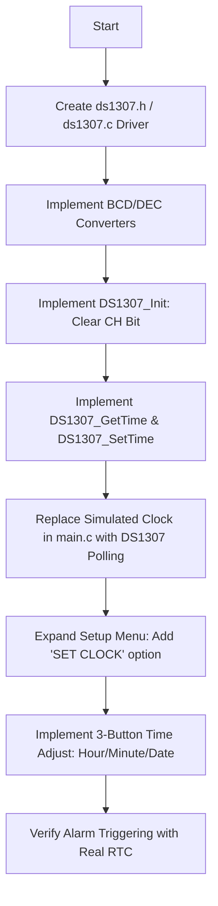

# Smart Pill Box - Firmware Architecture & DS1307 RTC Integration Plan

## 1. Overview
The Smart Pill Box is an STM32F103C8T6 (Blue Pill) project designed to alert users when to take specific medications (Pill 1 and Pill 2), confirm intake via dedicated pushbuttons, and prevent accidental medication errors with audio/visual warnings.

This document details the architecture and roadmap for integrating the **DS1307 Real-Time Clock (I2C)** module, enabling real battery-backed timekeeping and on-device time adjustment, and outlines future persistence via an **SD Card module**.

---

## 2. Hardware Architecture & Pin Allocation

### Current Pinout
| Component | STM32 Pin | Interface / Mode | Notes |
| :--- | :--- | :--- | :--- |
| **SSD1306 OLED SCL** | `PB6` | I2C1 SCL | 400 kHz / Standard I2C |
| **SSD1306 OLED SDA** | `PB7` | I2C1 SDA | Shared I2C Bus |
| **DS1307 RTC SCL** | `PB6` | I2C1 SCL | Shares same I2C bus as OLED |
| **DS1307 RTC SDA** | `PB7` | I2C1 SDA | Shares same I2C bus as OLED |
| **Button 1** | `PB12` | GPIO In (Pull-Up) | Pill 1 Confirm / Menu Increment (+) |
| **Button 2** | `PB14` | GPIO In (Pull-Up) | Pill 2 Confirm / Menu Select / Next |
| **Button 3** | `PB15` | GPIO In (Pull-Up) | Open Setup Menu / Return |
| **Pill 1 LED** | `PB1` | GPIO Output | Active HIGH |
| **Pill 2 LED** | `PB10` | GPIO Output | Active HIGH |
| **Buzzer** | `PB0` | GPIO Output | Active HIGH Piezo |

> [!NOTE]
> **I2C Bus Sharing:** The SSD1306 OLED uses 7-bit address `0x3C` (STM32 8-bit shifted: `0x78`). The DS1307 RTC uses 7-bit address `0x68` (STM32 8-bit shifted: `0xD0`). Because the addresses are distinct, both devices sit on the exact same pins (`PB6` & `PB7`) on `hi2c1`.

---

## 3. How the DS1307 RTC Works

### 3.1 I2C Communication & Addressing
* **7-bit Address:** `0x68`
* **8-bit Write Address:** `0xD0`
* **8-bit Read Address:** `0xD1`

### 3.2 Register Layout & BCD Format
The DS1307 stores time/date in registers `0x00` through `0x06` in **Binary Coded Decimal (BCD)**:
* `0x00`: Seconds (`00-59`) & Clock Halt (`CH`) bit (bit 7: 0 = oscillator running, 1 = halted).
* `0x01`: Minutes (`00-59`).
* `0x02`: Hours (`00-23` in 24-hr mode).
* `0x03`: Day of week (`1-7`).
* `0x04`: Date (`01-31`).
* `0x05`: Month (`01-12`).
* `0x06`: Year (`00-99`, offset from 2000).

```
Dec to BCD:  ((dec / 10) << 4) | (dec % 10)
BCD to Dec:  ((bcd >> 4) * 10) + (bcd & 0x0F)
```

---

## 4. Implementation Steps: Step-by-Step



### Step 1: Dedicated Driver (`ds1307.h` / `ds1307.c`)
* Expose clean data structure:
  ```c
  typedef struct {
      uint8_t seconds;
      uint8_t minutes;
      uint8_t hours;
      uint8_t dayOfWeek;
      uint8_t date;
      uint8_t month;
      uint16_t year;
  } RTC_DateTime_t;
  ```
* Functions:
  * `HAL_StatusTypeDef DS1307_Init(I2C_HandleTypeDef *hi2c);` (checks presence and ensures oscillator is running)
  * `HAL_StatusTypeDef DS1307_GetTime(RTC_DateTime_t *dt);`
  * `HAL_StatusTypeDef DS1307_SetTime(const RTC_DateTime_t *dt);`

### Step 2: Main Loop Clock Reading
* Every 500ms–1000ms, call `DS1307_GetTime(&currentTime)`.
* If I2C communication temporarily fails, fallback to tick-based interpolation to prevent clock freeze.
* Feed real `hours`, `minutes`, and `seconds` to `printHeader()` and alarm comparison conditions.

### Step 3: Expanding the 3-Button Menu to Adjust RTC Time
We will expand the setup state machine:
1. **Setup Menu Options:**
   - `> 1. SET PILL 1 TIME`
   - `> 2. SET PILL 2 TIME`
   - `> 3. ADJUST CLOCK`
2. **Clock Adjust States:**
   - `SETUP_CLOCK_HOUR`: Button 1 advances hour (`0-23`), Button 2 moves to minute.
   - `SETUP_CLOCK_MINUTE`: Button 1 advances minute (`0-59`), Button 2 moves to confirm.
   - `SETUP_CLOCK_CONFIRM`: Button 1 toggles Yes/Cancel, Button 2 commits write to DS1307 registers over I2C.

---

## 5. Future Roadmap: SD Card Integration
*(To be implemented in subsequent phase)*
* **Interface**: SPI (SPI1 or SPI2 on STM32) with FatFS library.
* **Persistent Settings (`config.txt`)**: Store Pill 1 and Pill 2 times across power outages.
* **Intake Logging (`doses.csv`)**: Record timestamps of taken doses and missed/wrong-button attempts:
  ```csv
  Date,Time,Event,Status
  2026-10-31,07:30:14,PILL_1,TAKEN_ON_TIME
  2026-10-31,19:02:05,PILL_2,TAKEN_AFTER_WARNING
  ```

