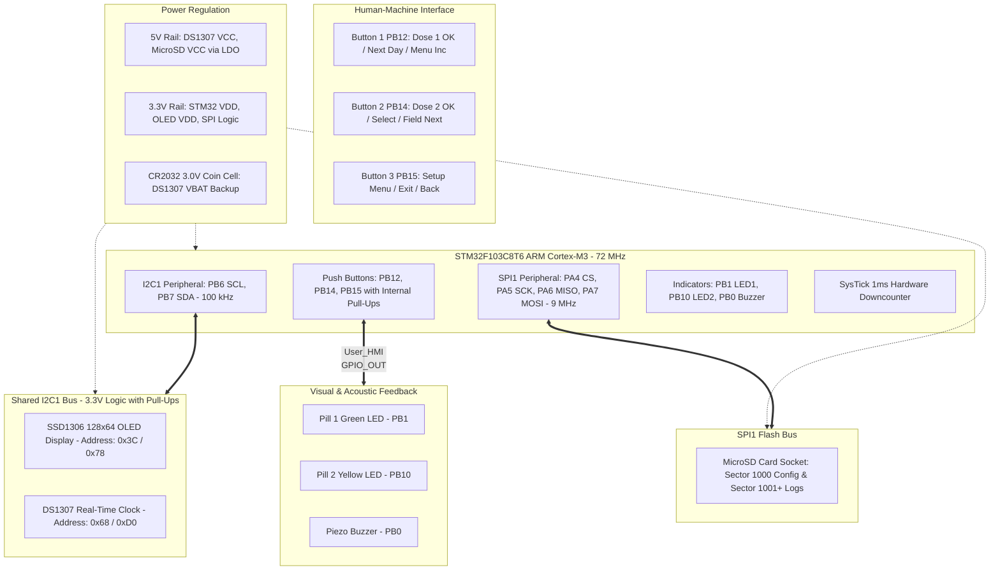
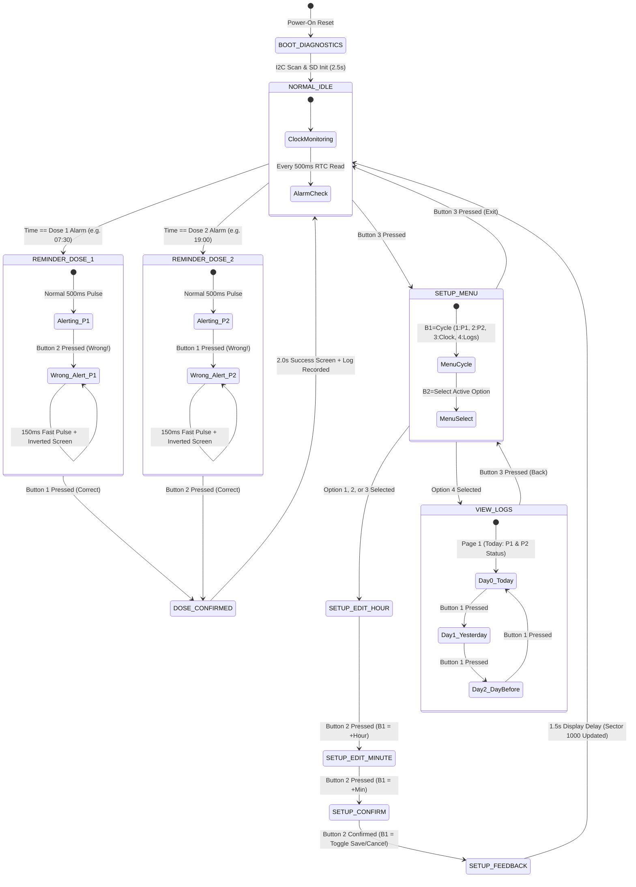

# Project Overview & System Architecture

## 1. Project Title & Mission
**Smart Pill Box Reminder & Medication Safety Monitor with Embedded SD Logging & On-OLED Dosage History**

The Smart Pill Box is an embedded medical-grade adherence device constructed on the **STM32F103C8T6 (ARM Cortex-M3)** microcontroller. Designed to bridge healthcare adherence and embedded safety, the system provides:
1. **Scheduled Medication Reminders**: Dual-alarm daily schedules (Pill 1 and Pill 2) configured with exact minutes and hours.
2. **Multi-Sensory Audio-Visual Alerting**: 0.96-inch monochrome I2C OLED display, dedicated pill indicator LEDs, and an acoustic piezo frequency alert.
3. **Active Error Prevention ("Wrong Pill" Safety Interlock)**: If a patient presses the wrong confirmation button during an alarm window, the device immediately switches to a high-frequency 150 ms acoustic alarm and displays an inverted video warning screen (`"WRONG PILL!"`), preventing double-dosing and incorrect medication intake.
4. **On-OLED 3-Day Dosage History Viewer (1 Page per Day)**: Allows the user or physician to review medication compliance for Today, Yesterday (-1d), and Day Before (-2d) directly on the screen without needing a computer.
5. **Persistent Storage & Audit Trail via MicroSD (SPI1)**: Saves alarm schedules to **Sector 1000** so settings survive power outages, and logs every confirmation and warning event to **Sector 1001+** with timestamps.
6. **Battery-Backed Real-Time Clock**: DS1307 RTC with CR2032 coin cell maintaining wall-clock time, with automatic fallback to MCU SysTick software clock interpolation if the RTC is unpowered.
7. **Complete On-Device 3-Button HMI**: 100% offline configuration (Pill 1 time, Pill 2 time, RTC clock adjustment, and log review).

---

## 2. Hardware Architecture & Block Diagram

---

## 3. Comprehensive Wiring & Pinout Table

| Peripheral | Signal | Pin | Electrical Mode | Voltage Level | Hardware Function |
| :--- | :--- | :--- | :--- | :--- | :--- |
| **I2C1** | `SCL` | `PB6` | AF Open-Drain (`GPIO_MODE_AF_OD`) | 5V-Tolerant (FT) | Shared I2C clock line (100 kHz) |
| **I2C1** | `SDA` | `PB7` | AF Open-Drain (`GPIO_MODE_AF_OD`) | 5V-Tolerant (FT) | Shared I2C data line |
| **SPI1** | `CS` | `PA4` | GPIO Push-Pull (`GPIO_MODE_OUTPUT_PP`) | 3.3V Logic | SD Card Chip Select (Active LOW) |
| **SPI1** | `SCK` | `PA5` | AF Push-Pull (`GPIO_MODE_AF_PP`) | 3.3V Logic | SPI1 Bus Clock (281 kHz init / 9 MHz transfer) |
| **SPI1** | `MISO` | `PA6` | Input Pull-Up (`GPIO_MODE_INPUT`) | 3.3V Max (Non-FT) | Serial Data from SD card to MCU |
| **SPI1** | `MOSI` | `PA7` | AF Push-Pull (`GPIO_MODE_AF_PP`) | 3.3V Logic | Serial Data from MCU to SD card |
| **Button 1** | `BTN1` | `PB12` | GPIO Input Pull-Up (`GPIO_PULLUP`) | 5V-Tolerant (FT) | Pill 1 Confirm / Menu Increment (+) / Next Day |
| **Button 2** | `BTN2` | `PB14` | GPIO Input Pull-Up (`GPIO_PULLUP`) | 5V-Tolerant (FT) | Pill 2 Confirm / Menu Select / Next Field |
| **Button 3** | `BTN3` | `PB15` | GPIO Input Pull-Up (`GPIO_PULLUP`) | 5V-Tolerant (FT) | Setup Menu Open / Discard / Back |
| **LED 1** | `P1_LED`| `PB1` | GPIO Push-Pull (`GPIO_MODE_OUTPUT_PP`) | 3.3V (20mA max) | Pill 1 Active Reminder Visual Output |
| **LED 2** | `P2_LED`| `PB10`| GPIO Push-Pull (`GPIO_MODE_OUTPUT_PP`) | 3.3V (20mA max) | Pill 2 Active Reminder Visual Output |
| **Buzzer** | `BUZZ` | `PB0` | GPIO Push-Pull (`GPIO_MODE_OUTPUT_PP`) | 3.3V Drive | Piezo Buzzer Acoustic Frequency Output |
| **ST-Link** | `SWDIO`| `PA13`| Serial Wire Data In/Out | 3.3V Logic | Hardware In-Circuit Debugging & Flashing |
| **ST-Link** | `SWCLK`| `PA14`| Serial Wire Clock | 3.3V Logic | Hardware Debugging Clock |

---

## 4. Software State Machine Architecture

The firmware is structured as a deterministic, non-blocking cooperative super-loop based on a Finite State Machine (FSM):

---

## 5. Critical Engineering Decisions: CSE vs. ECE Perspective

### 5.1 Why Open-Drain for I2C instead of Push-Pull?
In standard push-pull mode, a pin actively drives HIGH (connecting to $V_{DD}$) or LOW (connecting to GND). If two devices on a shared bus drive opposite logic levels simultaneously, a direct short-circuit occurs ($V_{DD}$ to GND through low-impedance MOSFETs), destroying the silicon. Open-drain outputs only pull LOW (via an NMOS switch) or float in high-impedance (Hi-Z). Bus pull-up resistors passively pull the lines HIGH when all devices release the bus, creating a **wired-AND** configuration that permits multi-drop communication and clock stretching.

### 5.2 Why Hardware SPI1 for MicroSD instead of Bit-Banging?
Hardware SPI1 uses the STM32's dedicated master synchronous serial hardware, driven directly by $PCLK2$ (72 MHz). By configuring the prescaler to `/8`, the MCU achieves a transmission baud rate of **$9\text{ Mbit/s}$** ($1.125\text{ MB/s}$), completing a 512-byte sector read or write in less than $0.6\text{ ms}$, ensuring zero perceptible latency in user interaction.

### 5.3 Deterministic Real-Time Behavior Without an RTOS
For small medical devices requiring fail-safe reliability, an RTOS adds task context-switch overhead, stack memory fragmentation, and priority inversion risks. Our system uses a **single super-loop cooperative architecture** driven by `HAL_GetTick()`. State transitions execute in under $50\,\mu\text{s}$, and time slicing guarantees that display updates, alarm checks, and debounce routines never block one another.
