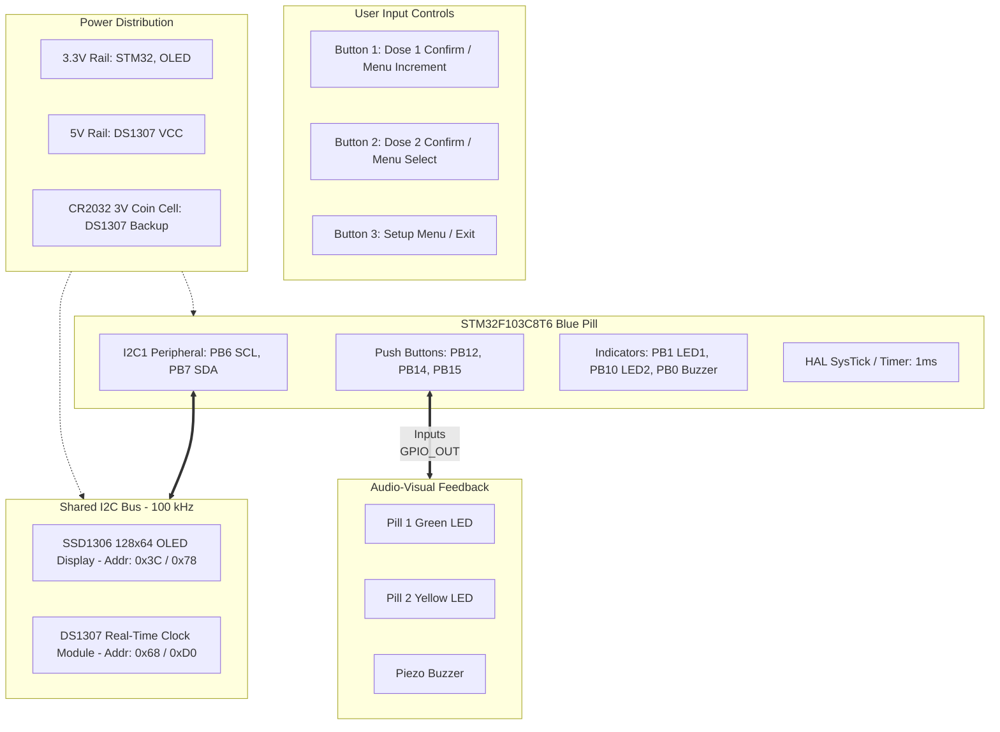
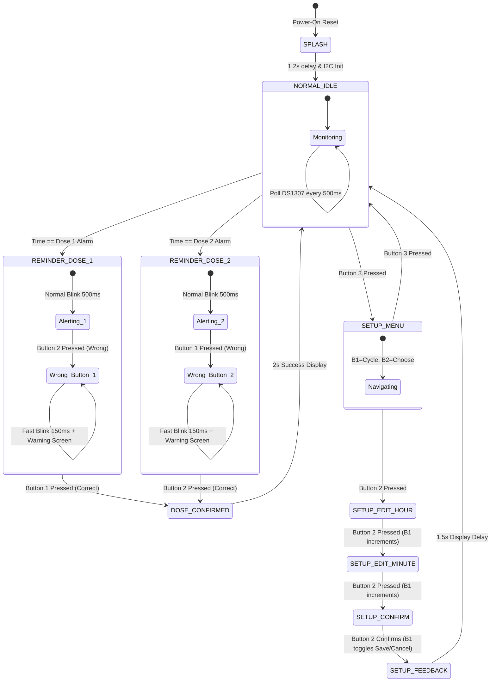

# Project Overview & System Architecture

## 1. Project Title & Purpose
**Smart Pill Box Reminder & Medication Safety Monitor**

The Smart Pill Box is an embedded healthcare assistance device built on the **STM32F103C8T6 (ARM Cortex-M3)** microcontroller. Its primary purpose is to:
1. Provide accurate, real-world scheduled medication alarms for patients taking multiple daily doses.
2. Ensure patient adherence through audio-visual reminders (SSD1306 OLED, LEDs, Piezo buzzer).
3. Prevent dangerous medication errors using an active verification system ("Wrong Pill" alert mechanism).
4. Allow complete offline configuration through a simple 3-button human-machine interface (HMI).
5. Maintain long-term real time using a battery-backed DS1307 Real-Time Clock module over I2C.

---

## 2. Hardware Architecture & Block Diagram

---

## 3. System Wiring & Pinout Table

| Peripheral | Signal | STM32 Pin | Mode | Purpose |
| :--- | :--- | :--- | :--- | :--- |
| **I2C1** | SCL | `PB6` | AF Open-Drain + External Pullup | Clock line for OLED & DS1307 |
| **I2C1** | SDA | `PB7` | AF Open-Drain + External Pullup | Data line for OLED & DS1307 |
| **Button 1** | Input | `PB12` | GPIO Input (Internal Pull-Up) | Pill 1 OK / Value Increment (+) |
| **Button 2** | Input | `PB14` | GPIO Input (Internal Pull-Up) | Pill 2 OK / Menu Item Select / Next |
| **Button 3** | Input | `PB15` | GPIO Input (Internal Pull-Up) | Setup Menu Open / Exit |
| **Pill 1 LED** | Output | `PB1` | GPIO Push-Pull Output | Pill 1 Visual Reminder Indicator |
| **Pill 2 LED** | Output | `PB10` | GPIO Push-Pull Output | Pill 2 Visual Reminder Indicator |
| **Buzzer** | Output | `PB0` | GPIO Push-Pull Output | Audible Frequency Alert |
| **ST-Link v2** | SWDIO | `PA13` | Serial Wire Data IO | SWD Debug / Flashing |
| **ST-Link v2** | SWCLK | `PA14` | Serial Wire Clock | SWD Debug / Flashing |

---

## 4. Software State Machine Workflow

---

## 5. Potential Evaluator Questions & Key Answers
* **Q: Why are both the OLED and RTC connected to the same pins (`PB6` and `PB7`)?**
  * *A: I2C is a shared bus protocol. Each peripheral has a distinct 7-bit hardware address (OLED: `0x3C`, RTC: `0x68`). The master initiates transfers by broadcasting the address, allowing multiple slaves on two wires.*
* **Q: What happens if the power cuts off?**
  * *A: The DS1307 module has a CR2032 coin battery backup, ensuring real time ticks continuously. When power restores, the STM32 immediately polls the RTC and retrieves the accurate wall-clock time.*
* **Q: How does the system prevent accidental double-dosing or multiple alarms in the same minute?**
  * *A: In the alarm evaluation logic, each dose struct holds `lastTriggeredDay`. Once triggered on day `X`, the alarm won't rearm until day `X+1` or until modified in the menu.*

