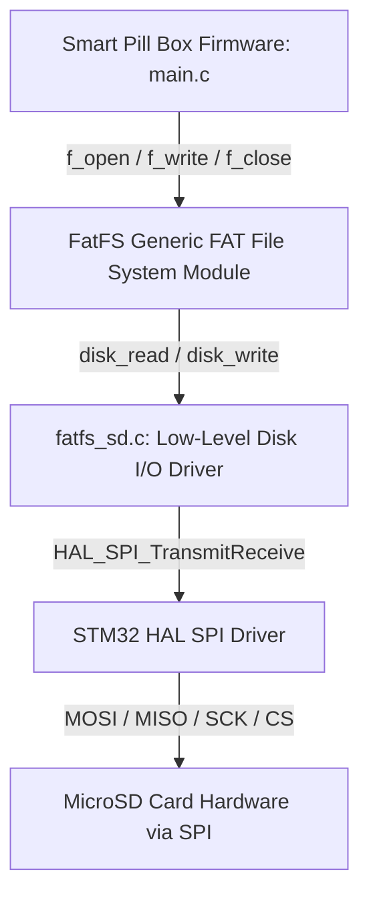

# Future Roadmap: SPI MicroSD Card Storage & FatFS Logging

## 1. Objective of the SD Card Subsystem
In the next development phase, an SPI-based MicroSD card module will be added to provide:
1. **Intake Event Logging**: Record historical logs of taken doses, time discrepancies, and incorrect button alerts into a comma-separated values (`doses.csv`) file.
2. **Persistent Configuration**: Store user-configured alarm times (`config.ini` or `config.txt`) so schedules persist even if the MCU is fully power cycled or reprogrammed.

---

## 2. Hardware Interface & Pin Allocation

The MicroSD module communicates with the STM32 via **Serial Peripheral Interface (SPI)**. On the STM32F103C8T6, **SPI2** or **SPI1** can be utilized:

| SD Card Pin | Suggested Pin (SPI2) | Mode / Alternate Function | Notes |
| :--- | :--- | :--- | :--- |
| **CS (Chip Select)** | `PB12` (or spare pin e.g. `PA4` / `PB9`) | GPIO Output (Active LOW) | Enables SD communication |
| **SCK (Clock)** | `PB13` | SPI2 SCK | SPI Clock generated by STM32 |
| **MISO (Master In)** | `PB14` (Remap or use `PA6` for SPI1) | SPI2 MISO | Data sent from SD card to MCU |
| **MOSI (Master Out)**| `PB15` (Remap or use `PA7` for SPI1) | SPI2 MOSI | Data sent from MCU to SD card |
| **VCC** | `3.3V` or `5V` | Power Supply | Depends on module voltage regulator |
| **GND** | `GND` | Ground Reference | Common ground |

> [!NOTE]
> Currently, `PB12`, `PB14`, and `PB15` are assigned to push buttons. For SD card integration, we can either:
> 1. Use **SPI1** (`PA5` = SCK, `PA6` = MISO, `PA7` = MOSI, `PA4` = CS), leaving GPIOB pins exclusively for buttons.
> 2. Move buttons to available pins on GPIOA (e.g. `PA0`, `PA1`, `PA2`).

---

## 3. Software Architecture (FatFS + HAL SPI)



### 3.1 Proposed CSV Log Format (`doses.csv`)
Each dose event is appended with date and timestamp retrieved directly from the DS1307 RTC:
```csv
Date,Time,Event,Details
2026-10-31,07:30:15,DOSE_TAKEN,Pill 1 taken on time
2026-10-31,19:00:48,WRONG_BUTTON,Pill 2 due - Button 1 pressed
2026-10-31,19:01:05,DOSE_TAKEN,Pill 2 confirmed taken
```

---

## 4. Potential Evaluator Questions & Answers

* **Q: Why use SPI mode for SD cards instead of SDIO?**
  * *A: The STM32F103C8T6 does not feature an SDIO peripheral (SDIO is present on F103Rx/Vx high-density devices). SPI mode allows standard MicroSD communication using only 4 pins with lower software complexity and full FatFS compatibility.*
* **Q: What is FatFS?**
  * *A: FatFS is an open-source FAT/exFAT filesystem module for small embedded systems written by ChaN. It is completely hardware-independent, requiring only a low-level driver interface (`disk_initialize`, `disk_read`, `disk_write`, `disk_ioctl`).*
* **Q: How will configuration files be read on startup?**
  * *A: In `main()`, after initializing SPI and mounting the card (`f_mount`), the firmware opens `config.txt` (`f_open`). If the file exists, it parses the alarm hours and minutes (`f_scanf` or `f_gets`), overriding factory default values.*

