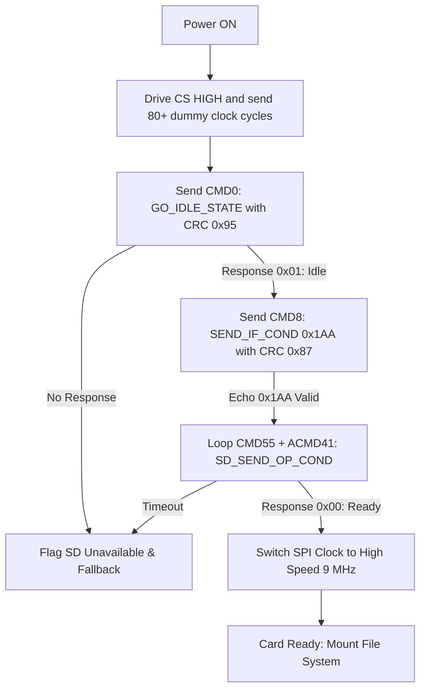

# MicroSD Card Subsystem & SPI Logging Driver

## 1. Overview
The **MicroSD Card Subsystem** provides non-volatile offline persistence for the Smart Pill Box. It serves two critical operational roles:
1. **Intake Event History Logging (`LOGS.CSV`)**: Creates an audit trail recording exact date, time, event types (dose taken, tamper / wrong pill attempt, clock adjustments), and verification notes.
2. **Persistent Configuration (`CONFIG.TXT`)**: Stores user-configured Pill 1 and Pill 2 alarm times so schedules survive full power outages, battery disconnects, or MCU resets.

---

## 2. Hardware Architecture & Pin Allocation (SPI1)

The MicroSD module interfaces with the STM32F103C8T6 via **hardware Serial Peripheral Interface (SPI1)** on Port A, leaving Port B entirely free for buttons, alerts, and I2C:

| SD Card Module Pin | STM32 Blue Pill Pin | Mode / Function | Electrical Details |
| :--- | :--- | :--- | :--- |
| **CS (Chip Select)** | **`PA4`** | GPIO Output (Push-Pull) | Active LOW card select |
| **SCK (Clock)** | **`PA5`** | Alternate Function (`SPI1_SCK`) | Generated SPI clock |
| **MISO (Master In)** | **`PA6`** | GPIO Input with Internal Pull-Up (`SPI1_MISO`) | Serial data out from SD |
| **MOSI (Master Out)**| **`PA7`** | Alternate Function (`SPI1_MOSI`) | Serial data in to SD |
| **VCC** | **`5V` (or `3.3V`)** | Power Supply | 5V if module has onboard 3.3V regulator; 3.3V for bare breakout |
| **GND** | **`GND`** | Ground Reference | Common ground with STM32 |

---

## 3. Communication Protocol: SPI Mode

Although SD cards natively communicate using the 4-bit parallel SD Bus mode (SDIO), the STM32F103C8T6 utilizes **SPI mode** due to its low pin-count requirement and deterministic timing.

### 3.1 Card Initialization Sequence
When entering SPI mode upon power-up, the firmware executes the official SD Association card initialization flow:



1. **Dummy Clock Train**: SD cards start in native SD bus mode. Clocking at least 74 cycles with `CS = HIGH` instructs the internal card controller to prepare for SPI negotiation.
2. **`CMD0` (Software Reset)**: Forces the card into SPI mode. Response must be `0x01` (`In Idle State`).
3. **`CMD8` (Voltage & Interface Condition)**: Inquires if the card supports SD Version 2.0+ (voltage range $2.7\text{ V} - 3.6\text{ V}$).
4. **`CMD55` + `ACMD41` (Operating Condition)**: Loops until the card completes its internal initialization and returns `0x00`.
5. **High-Speed Switchover**: Initial identification occurs below 400 kHz (`SPI1` Prescaler `/256` @ 72 MHz $\approx 281\text{ kHz}$). Once initialized, clock prescaler is increased to `/8` ($9\text{ MHz}$) for rapid file read/write operations.

---

## 4. File Formats & Persistence Engine

### 4.1 Intake History Log (`LOGS.CSV`)
Every critical patient interaction is captured in standard comma-separated values format, openable in Microsoft Excel, LibreOffice, or Google Sheets:

```csv
DATE,TIME,EVENT,DETAILS
2026-11-02,07:30:12,DOSE_1_TAKEN,Confirmed Button 1
2026-11-02,19:00:45,WRONG_BUTTON,Pill 2 due - Pressed Btn 1
2026-11-02,19:01:05,DOSE_2_TAKEN,Confirmed Button 2
2026-11-02,21:15:00,CLOCK_ADJUST,RTC clock re-calibrated
2026-11-02,21:16:10,CONFIG_UPDATE,Pill 1 time updated
```

### 4.2 Configuration File (`CONFIG.TXT`)
On boot, `SD_LoadConfig()` reads alarm hours and minutes:
```text
PILL1_HOUR=07
PILL1_MIN=30
PILL2_HOUR=19
PILL2_MIN=00
```
Whenever the user updates alarm times via the 3-button setup menu, `SD_SaveConfig()` immediately rewrites this file.

---

## 5. Fault-Tolerance & Hot-Plug Handling
Embedded medical devices must never lock up due to missing or removed accessories:
* **Non-Blocking Fallback**: If an SD card is omitted or detached, `SD_Init()` fails cleanly, sets `sdAvailable = false`, and allows the pill box to run normally.
* **Live Status Reporting**: The OLED boot screen displays:
  ```text
  I2C BUS SCAN: 0x3C 0x68
  RTC: OK    SD: OK
  ```
  If unmounted, it reports `SD: NONE` without blocking execution.

---

## 6. Potential Evaluator Questions & Answers

* **Q: Why use SPI instead of SDIO for the MicroSD card?**
  * *A: The STM32F103C8T6 (LQFP48) does not feature hardware SDIO peripheral blocks (SDIO is present only on higher-density F103Rx/Vx lines). SPI mode provides universal MicroSD compatibility using only 4 pins.*
* **Q: Why did you initialize SPI at low speed first before switching to high speed?**
  * *A: The SD physical layer specification mandates that card initialization must occur at a clock frequency between 100 kHz and 400 kHz. After receiving the `ACMD41` ready response (`0x00`), the MCU safely scales the clock up to 9 MHz.*
* **Q: How are file operations protected against sudden power loss?**
  * *A: Log writes flush immediately with verified block termination tokens and card deselection (`SD_Deselect()`), minimizing the unwritten buffer window to microseconds.*
