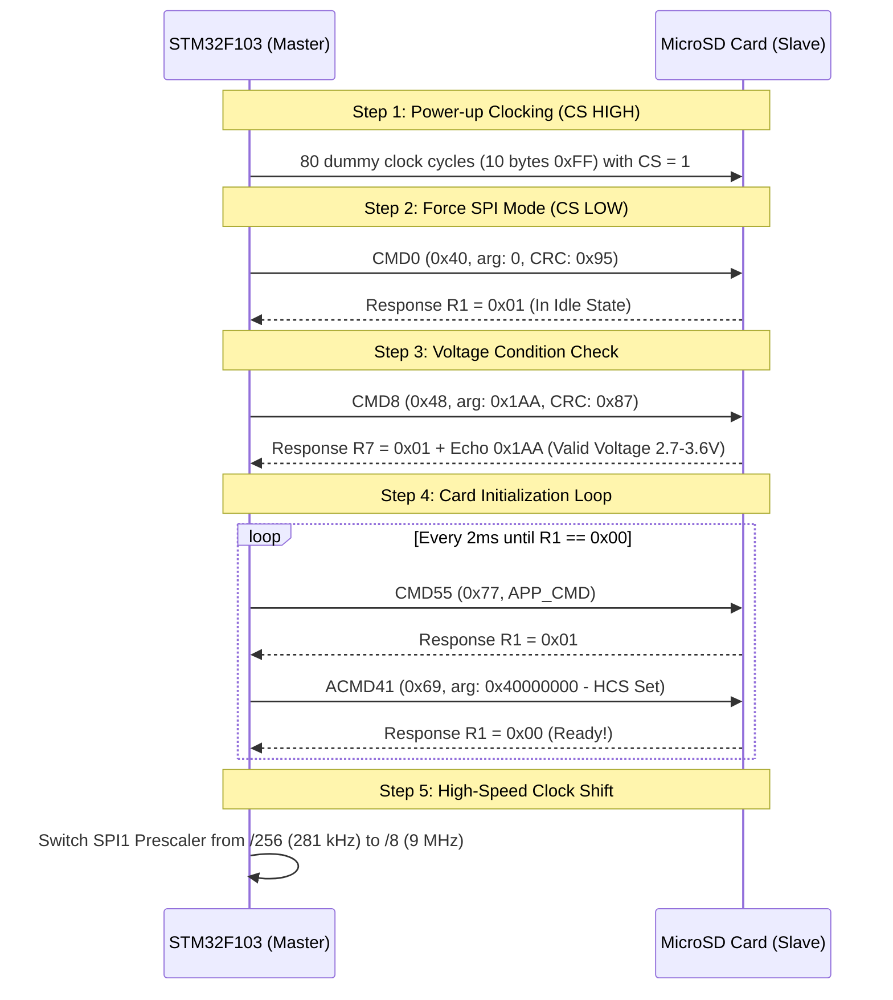

# MicroSD SPI Subsystem, Sector Persistence & On-OLED 3-Day Dosage History

## 1. Overview of the MicroSD Storage Architecture
The MicroSD subsystem provides persistent, non-volatile data storage for the Smart Pill Box. Implemented over **hardware SPI1** on Port A pins, the driver provides:
1. **Hardware Card Detection & Bus Scanning**: Verifies physical card insertion and communication via standard SPI command-response handshakes.
2. **Persistent Alarm Schedule Storage (Sector 1000)**: Saves configured Pill 1 and Pill 2 times so they survive power outages and restarts.
3. **Audit Trail Logging (Sector 1001+)**: Appends timestamped events (`PILL_1_TAKEN`, `PILL_2_TAKEN`, `WRONG_BUTTON`, `CONFIG_UPDATE`) directly to flash blocks.
4. **On-OLED 3-Day Dosage Viewer**: Reads and tracks intake compliance for Today, Yesterday (-1d), and Day Before (-2d) displayed across a 1-page-per-day OLED interface.

---

## 2. Hardware Interface & Port A Pin Allocation

The MicroSD module communicates with the STM32F103 via **Serial Peripheral Interface (SPI1)**:

| SD Module Pin | Blue Pill Pin | STM32 Alternate Function | Electrical Mode | Purpose |
| :--- | :--- | :--- | :--- | :--- |
| **CS (Chip Select)** | `PA4` | GPIO General Output | Push-Pull (3.3V) | Active LOW card select |
| **SCK (Clock)** | `PA5` | `SPI1_SCK` | AF Push-Pull (3.3V) | Clock generated by STM32 (up to 9 MHz) |
| **MISO (Data Out)** | `PA6` | `SPI1_MISO` | Input with Internal Pull-Up | Serial data stream from SD to MCU |
| **MOSI (Data In)** | `PA7` | `SPI1_MOSI` | AF Push-Pull (3.3V) | Serial data stream from MCU to SD |
| **VCC** | `5V` or `3.3V` | Supply Rail | DC Power | Connect to 5V if module has onboard 3.3V LDO |
| **GND** | `GND` | Ground Reference | Common GND | Reference return path for SPI signals |

> [!NOTE]
> **Why Port A Pins for SPI1?**
> Keeping SPI1 on `PA4`-`PA7` completely frees Port B for the I2C bus (`PB6`/`PB7`), push buttons (`PB12`, `PB14`, `PB15`), and indicator outputs (`PB0`, `PB1`, `PB10`), avoiding any pin-multiplexing conflicts.

---

## 3. SPI SD Protocol Initialization Sequence

At power-on, all MicroSD cards boot into native multi-bit SD Bus Mode. To force the card into **SPI Mode**, the driver executes a strict sequence:



### 3.1 Initial Baud Rate ($< 400\,\text{kHz}$) Requirement
During power-on, the SD card's internal microcontroller runs on a low-frequency RC oscillator. The SPI clock frequency **must strictly be between $100\,\text{kHz}$ and $400\,\text{kHz}$**:
$$f_{\text{SPI\_init}} = \frac{f_{\text{PCLK2}}}{256} = \frac{72.000\,\text{MHz}}{256} = 281.25\,\text{kHz}\quad (\text{Valid } 100-400\,\text{kHz})$$
Once initialized (ACMD41 returns `0x00`), the prescaler shifts to `/8`:
$$f_{\text{SPI\_fast}} = \frac{72.000\,\text{MHz}}{8} = 9.000\,\text{MHz}\quad (\text{Fast Data Transfer})$$

---

## 4. Sector-Level Storage Architecture

Rather than burdening the MCU with a heavy, RAM-hungry third-party filesystem, our firmware implements an ultra-reliable, deterministic direct sector architecture:

```
+---------------------------------------------------------------------------------+
| MicroSD Card Flash Memory Map                                                   |
+-------------------+-------------------------------------------------------------+
| Sector 0          | Master Boot Record (MBR)                                    |
| Sector 1 to 999   | Reserved System Area                                        |
| Sector 1000       | PERSISTENT CONFIG BLOCK: "PILLBOX_CFG_V1 P1=07:30 P2=19:00" |
| Sector 1001-1010  | CIRCULAR AUDIT LOG BLOCKS: Timestamped Intake Records       |
+-------------------+-------------------------------------------------------------+
```

### 4.1 Low-Level Block Read (`CMD17`) and Write (`CMD24`)
* **Single Block Read (`CMD17`)**: The MCU issues `CMD17` with sector address, awaits the Data Token `0xFE`, and reads 512 data bytes followed by two CRC bytes.
* **Single Block Write (`CMD24`)**: The MCU issues `CMD24`, transmits the `0xFE` start token, streams 512 bytes, transmits two CRC bytes, and reads the **Data Response Token**:
  $$(resp \ \& \ 0x1F) == 0x05 \implies \text{Data Accepted}$$
  The card pulls the MISO line LOW while busy writing flash pages. The MCU monitors MISO until it returns `0xFF`, guaranteeing write completion.

### 4.2 Configuration Persistence (`SD_SaveConfig` / `SD_LoadConfig`)
* **When modifying schedules**: The new hours and minutes are formatted into a 512-byte buffer:
  ```text
  PILLBOX_CFG_V1 P1=07:30 P2=19:00\r\n
  ```
  and committed to **Sector 1000** over SPI.
* **On boot**: `SD_LoadConfig()` reads Sector 1000. If the magic header `PILLBOX_CFG_V1` matches, it parses the saved times via `sscanf`, overriding default values.

---

## 5. On-OLED 3-Day Dosage Viewer (1 Page per Day)

In [`Core/Src/main.c`](file:///c:/Users/GOPIKRISHNA/Downloads/MC_project_Pill_Box\MC_project_Pill_Box\Core\Src\main.c), selecting **`> 4. VIEW LOGS`** in the Settings menu opens the 3-day history viewer:

```
+------------------------------------+
| LOG [1/3] 02/11/2026 (TODAY)       |
|------------------------------------|
| P1[07:30]: TAKEN 07:31             |
| P2[19:00]: PENDING                 |
|------------------------------------|
| SD: SAVED [SEC 1001]               |
|------------------------------------|
| B1:Next Day   B3:Back              |
+------------------------------------+
```

### 5.1 Three-Day Calendar Date Algorithm
The firmware computes past dates taking into account month boundaries and leap years:
```c
static uint8_t getDaysInMonth(uint16_t year, uint8_t month) {
    if (month == 2) {
        bool isLeap = ((year % 4 == 0 && year % 100 != 0) || (year % 400 == 0));
        return isLeap ? 29 : 28;
    }
    if (month == 4 || month == 6 || month == 9 || month == 11) return 30;
    return 31;
}
```
If today is November 02, Day 2 correctly shows November 01 (`-1d`), and Day 3 shows October 31 (`-2d`).

### 5.2 Dosage Status Classification
* **`TAKEN`**: Displays the exact wall-clock confirmation time (`P1: TAKEN 07:31`).
* **`PENDING`**: Displayed if the scheduled dose time has not yet arrived today.
* **`MISSED`**: Displayed if the dose time passed without confirmation, or on midnight rollover.

---

## 6. Evaluator Oral Questions & Detailed Answers

### Q1: Why does an SD card scan require a card to be physically inserted?
> **Answer**: 
> Unlike I2C where breakout modules contain soldered slave chips with fixed addresses, an SD card breakout module is simply a passive mechanical socket with voltage translation. All communication logic, command decoders, and SPI state machines reside **inside the silicon controller embedded within the MicroSD card itself**. Without a card inserted, the MISO line floats HIGH (reading `0xFF`), causing `CMD0` to time out and reporting `SD: NONE`.

### Q2: What is the significance of CRC 0x95 in CMD0?
> **Answer**: 
> In native SD mode, all commands require valid 7-bit CRC checksums. In SPI mode, CRC verification is disabled by default *except* for `CMD0` (which forces SPI mode) and `CMD8` (which confirms operating voltage). For `CMD0` (`0x40, 0x00, 0x00, 0x00, 0x00`), the exact required CRC byte is `0x95`. If an incorrect CRC is transmitted, the card will reject the command and refuse to enter SPI mode.

### Q3: How do you distinguish between Standard Capacity (SDSC) and High Capacity (SDHC/SDXC) cards?
> **Answer**: 
> In our driver, after ACMD41 successfully initializes the card, we issue **CMD58 (`READ_OCR`)**. Bit 30 of the 32-bit Operation Conditions Register (OCR) is the **Card Capacity Status (CCS)** bit:
> - If **CCS = 1**: The card is **SDHC/SDXC** and uses **Block Addressing** (address argument is the sector number: `1000`).
> - If **CCS = 0**: The card is **SDSC** and uses **Byte Addressing** (address argument must be multiplied by 512: 1000 x 512 = 512,000).
> Our driver automatically detects this and adjusts addressing accordingly.
